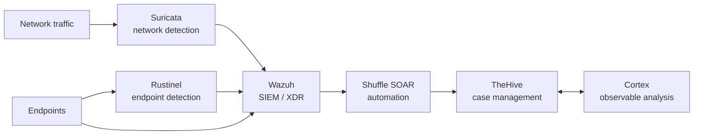
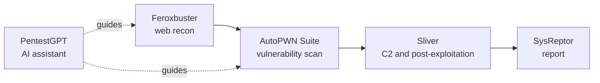

<!--
IMAGE CHECKLIST (replace these files with your own images; GitHub does not show this comment)
assets/images/banner.png                  (1280x400 recommended)
assets/images/tools/suricata.png          assets/images/tools/wazuh.png
assets/images/tools/rustinel.png          assets/images/tools/thehive.png
assets/images/tools/cortex.png            assets/images/tools/shuffle.png
assets/images/tools/feroxbuster.png       assets/images/tools/autopwn-suite.png
assets/images/tools/sliver.png            assets/images/tools/pentestgpt.png
assets/images/tools/sysreptor.png
assets/images/author.png                  (optional profile photo)
Tool images: 800x400 (2:1) recommended, same size for every tool so the page looks even.
-->

<div align="center">


# 🛠️ Security Tools Installation

**Step-by-step install and usage guides for 10 defensive and offensive security tools on Ubuntu Linux.**


Companion repository for the **SEC W TOM** YouTube series.
📺 [@TOmSec-OG](https://www.youtube.com/@TOmSec-OG) · 💻 [THeOLdMAn48](https://github.com/THeOLdMAn48/)

*Learn - Secure - Grow*

</div>

> ⚠️ **Legal and ethical notice.** Everything here is for **education and authorized testing only**. Run offensive tools **only on systems you own or have written permission to test** (for example your own isolated home-lab VMs). Unauthorized scanning, access, or attacks are illegal.

---

## 📑 Table of Contents

1. [About this repository](#1-about-this-repository)
2. [Tools at a glance](#2-tools-at-a-glance)
3. [🔵 Defensive tools (Blue Team & SOC)](#3--defensive-tools-blue-team--soc)
4. [🔴 Offensive tools (Pentesting & Red Team)](#4--offensive-tools-pentesting--red-team)
5. [How the tools fit together](#5-how-the-tools-fit-together)
6. [Series roadmap](#6-series-roadmap)
7. [What each guide contains](#7-what-each-guide-contains)
8. [Repository structure](#8-repository-structure)
9. [Recommended home lab](#9-recommended-home-lab)
10. [How to use this repository](#10-how-to-use-this-repository)
11. [Contributing](#11-contributing)
12. [Disclaimer](#12-disclaimer)
13. [Author](#13-author)

---

## 1. About this repository

Installing security tools is the hardest first step for most beginners. Official docs are long, commands change between versions, and one small mistake can cost hours.

This repository gives you **short, clear, copy-paste guides** to install and start using popular security tools on **Ubuntu**. Each tool has its own folder and README, matched with a video on the SEC W TOM channel.

The series covers both sides of cybersecurity:

- 🔵 **Defensive (Blue Team):** detect, monitor, investigate, and respond to threats.
- 🔴 **Offensive (Red Team):** find weaknesses and simulate attacks in a safe, authorized lab.

<p align="center">
  
</p>

---

## 2. Tools at a glance

| | Tool | Team | What it does | Status |
|---|---|---|---|---|
|  | **Wazuh** | 🔵 Blue | Open-source SIEM and XDR |  ✅ Available |
|  | [**Suricata**](./Suricata/) | 🔵 Blue | Network IDS/IPS and traffic monitoring | ✅ Available |
|  | **Rustinel** | 🔵 Blue | Lightweight endpoint detection agent | 🚧 Coming soon |
|  | **TheHive & Cortex** | 🔵 Blue | Incident response and case management, plus observable analysis | 🚧 Coming soon |
|  | **Shuffle SOAR** | 🔵 Blue | Security automation with visual workflows | 🚧 Coming soon |
|  | **Feroxbuster** | 🔴 Red | Fast web content and directory discovery | 🚧 Coming soon |
|  | **AutoPWN Suite** | 🔴 Red | Automated vulnerability scanning | 🚧 Coming soon |
|  | **Sliver** | 🔴 Red | Command and control (C2) framework | 🚧 Coming soon |
|  | **PentestGPT** | 🔴 Red | AI-assisted penetration testing | 🚧 Coming soon |
|  | **SysReptor** | 🔴 Red | Pentest report writing platform | 🚧 Coming soon |

**Legend:** ✅ guide published · 🚧 planned for the series. More tools will be added over time.

---

## 3. 🔵 Defensive tools (Blue Team & SOC)

Defensive tools let you **detect threats, correlate logs, investigate alerts, and automate incident response**.

---

### 3.1 Suricata

<p align="center">
  
</p>

| | |
|---|---|
| **Category** | Network IDS / IPS / Network Security Monitoring |
| **Best for** | Seeing and detecting threats in network traffic |
| **Status** | ✅ [Guide available](./Suricata/) |

**What it is:** A high-performance, multi-threaded network threat detection engine. It reads traffic, compares it with rules, and can alert or block.

**Key features**
- IDS (alert) and IPS (block) modes
- Deep protocol awareness (HTTP, DNS, TLS and more)
- Rich JSON logs (`eve.json`) that feed SIEM tools
- Huge free community rulesets plus your own custom rules

**In the guide:** install on Ubuntu, configuration, rule updates, reading logs, writing rules, 12 attack scenarios with detection rules, IPS mode, and tuning.

---

### 3.2 Wazuh

<p align="center">
  
</p>

| | |
|---|---|
| **Category** | SIEM / XDR |
| **Best for** | Central log analysis and endpoint monitoring |
| **Status** | 🚧 Coming soon |

**What it is:** A leading open-source security platform that monitors endpoints in real time and shows alerts in a web dashboard.

**Key features**
- Agents on endpoints that collect logs and security data
- Log analysis, file integrity monitoring, and alerting
- Web dashboard for searching and visualizing alerts
- Works with network tools such as Suricata by reading their logs

**In the video:** download and deploy Wazuh, connect an agent, and view security alerts in the dashboard.

---

### 3.3 Rustinel

<p align="center">
  
</p>

| | |
|---|---|
| **Category** | Endpoint detection agent (EDR-style) |
| **Best for** | Low-overhead host telemetry and behavior monitoring |
| **Status** | 🚧 Coming soon |

**What it is:** A lightweight, open-source endpoint detection agent written in Rust for **Windows and Linux**, built around one codebase and one rule workflow.

**Key features**
- Collects host events (ETW on Windows, eBPF on Linux)
- Three detection engines: **Sigma** rules, **YARA** signatures, and **IOC** matching
- Alerts written as ECS-compatible JSON lines for SIEM tools
- Optional active response with dry-run mode and allowlists
- Runs in user mode (no kernel driver)

**Good to know:** it is a young project, and its own documentation notes limits such as memory-only payloads and kernel-level tampering. Treat it as a learning and lightweight monitoring tool, not a full commercial EDR replacement. Source: [github.com/Karib0u/rustinel](https://github.com/Karib0u/rustinel).

**In the video:** install the agent, load detection rules, trigger a test behavior, and read the alert.

---

### 3.4 TheHive & Cortex

<p align="center">
  
  
</p>

| | |
|---|---|
| **Category** | Security Incident Response Platform (SIRP) and observable analysis |
| **Best for** | SOC case management and investigation workflow |
| **Status** | 🚧 Coming soon |

**What they are:**
- **TheHive** is a case management platform where analysts receive alerts, work on cases, track tasks, and document incident resolution.
- **Cortex** is its companion engine that analyzes **observables** (IPs, domains, file hashes, URLs) using many analyzers and can run response actions.

**Key features**
- Alerts turn into cases with tasks, notes, and timelines
- Observables can be sent to Cortex for enrichment
- Built for team collaboration in a SOC

**Good to know:** TheHive 5 has a free **Community** license, but you must request it through the StrangeBee license portal. Without a valid license, newer 5.x installs fall back to read-only mode after a trial. Check the [official license page](https://docs.strangebee.com/thehive/installation/licenses/about-licenses/) before you start.

**In the video:** a Tier-1 analyst flow: receive an alert, inspect observables, and document the resolution.

---

### 3.5 Shuffle SOAR

<p align="center">
  
</p>

| | |
|---|---|
| **Category** | SOAR (Security Orchestration, Automation and Response) |
| **Best for** | Automating repetitive SOC tasks |
| **Status** | 🚧 Coming soon |

**What it is:** An open-source SOAR platform with a **visual, node-based workflow builder**. You connect tools together and automate responses without heavy coding.

**Key features**
- Drag-and-drop workflow editor
- Many app integrations (threat intel, ticketing, messaging, SIEM)
- Triggers from webhooks or alerts, then actions across your tools

**In the video:** build an automated triage workflow, for example take an alert, query VirusTotal for the indicator, and notify or open a case.

---

## 4. 🔴 Offensive tools (Pentesting & Red Teaming)

Offensive tools show how attackers think: **reconnaissance, attack surface discovery, and exploitation, all inside a controlled lab.**

> 🔒 Use these only on your own lab machines or with written permission.

---

### 4.1 Feroxbuster

<p align="center">
  
</p>

| | |
|---|---|
| **Category** | Web reconnaissance |
| **Best for** | Finding hidden directories and files on web servers |
| **Status** | 🚧 Coming soon |

**What it is:** A fast, **recursive** content and directory discovery scanner written in Rust. It is a modern alternative to older tools like Dirb and Gobuster, with clear live feedback in the terminal.

**Key features**
- Recursive scanning of discovered directories
- Wordlist-based discovery with fast performance
- Filters for status codes, sizes, and extensions

**In the video:** install it, scan an intentionally vulnerable web app in your lab, and read the results.

---

### 4.2 AutoPWN Suite

<p align="center">
  
</p>

| | |
|---|---|
| **Category** | Vulnerability scanning |
| **Best for** | Quickly mapping open ports to known CVEs |
| **Status** | 🚧 Coming soon |

**What it is:** A Python-based automated vulnerability scanner. It scans ports and services, then correlates them with **known CVE vulnerabilities** to show likely weaknesses.

**Key features**
- Port and service scanning
- CVE matching for detected software versions
- Simple command-line workflow

**In the video:** scan your own lab target and walk through reconnaissance to vulnerability findings.

---

### 4.3 Sliver

<p align="center">
  
</p>

| | |
|---|---|
| **Category** | Command and Control (C2) / adversary simulation |
| **Best for** | Understanding attacker tradecraft and red-team operations |
| **Status** | 🚧 Coming soon |

**What it is:** An open-source C2 framework developed by **Bishop Fox**, often described as a modern alternative to commercial C2 tools.

**Key features**
- Cross-platform implant (payload) generation
- Multiple listener types, including mTLS
- Session management from a central server

**In the video:** set up the server, create a listener, and manage a session with a **lab VM you own**. Defenders can pair this with Suricata and Wazuh to see what the activity looks like.

---

### 4.4 PentestGPT

<p align="center">
  
</p>

| | |
|---|---|
| **Category** | AI-assisted penetration testing |
| **Best for** | Guiding pentest tasks with an LLM assistant |
| **Status** | 🚧 Coming soon |

**What it is:** An **LLM-powered** penetration testing assistant that helps structure attack paths and guides interactive pentesting tasks.

**Key features**
- Task planning and next-step suggestions
- Interactive, conversation-style workflow
- Useful for learning methodology

**Good to know:** it needs access to a language model (an API key or a compatible backend), so check the project's current setup requirements before recording. AI suggestions can be wrong, so always verify them.

**In the video:** install it and use it to guide a lab pentest, discussing the benefits and the limits of AI in offensive security.

---

### 4.5 SysReptor

<p align="center">
  
</p>

| | |
|---|---|
| **Category** | Pentest reporting |
| **Best for** | Writing professional, client-ready pentest reports |
| **Status** | 🚧 Coming soon |

**What it is:** A browser-based, self-hostable platform for writing penetration test reports. Reporting is the part many pentesters find hardest, so it makes a valuable tutorial.

**Key features**
- Report templates and reusable findings
- Browser-based editor
- Export to a polished document

**In the video:** set it up, create a project, add findings from your lab tests, and export a report.

---

## 5. How the tools fit together

### 🔵 A simple Blue Team pipeline



*Idea:* detect → collect and correlate → automate triage → investigate and respond. Not every tool needs to be linked in every lab, but this is how a real SOC pipeline is commonly shaped.

### 🔴 A simple Red Team flow



*Idea:* recon → find weaknesses → simulate the attacker → document everything.

### 🟣 Purple Team lab idea

Run a red-team action from the attacker VM, then use the blue-team tools to find it:

| Red team action | Blue team detection |
|---|---|
| Directory brute force with Feroxbuster | Suricata web rules, Wazuh web logs |
| Port and vulnerability scan with AutoPWN Suite | Suricata scan rules |
| Sliver session from a lab VM | Network alerts, endpoint telemetry |
| Any of the above | Alert → Shuffle → TheHive case |

This loop (attack, detect, respond) is the fastest way to learn.

---

## 6. Series roadmap

Suggested order (you can follow any order you like):

| # | Tool | Team | Skill you build | Status |
|---|---|---|---|---|
| 1 | Suricata | 🔵 | Network detection and rule writing | ✅ Available |
| 2 | Wazuh | 🔵 | SIEM basics and endpoint monitoring | 🚧 |
| 3 | Rustinel | 🔵 | Endpoint detection with Sigma/YARA | 🚧 |
| 4 | TheHive & Cortex | 🔵 | Incident response and case handling | 🚧 |
| 5 | Shuffle SOAR | 🔵 | Security automation | 🚧 |
| 6 | Feroxbuster | 🔴 | Web reconnaissance | 🚧 |
| 7 | AutoPWN Suite | 🔴 | Vulnerability scanning | 🚧 |
| 8 | Sliver | 🔴 | Adversary simulation | 🚧 |
| 9 | PentestGPT | 🔴 | AI-assisted pentesting | 🚧 |
| 10 | SysReptor | 🔴 | Professional reporting | 🚧 |

---

## 7. What each guide contains

Every tool folder follows the same structure so you always know where to look:

| Section | What you get |
|---|---|
| **Introduction** | What the tool is and why it matters |
| **Requirements** | What is mandatory and what is only recommended |
| **Installation** | Clear copy-paste steps for Ubuntu |
| **Configuration** | First-time setup and important files |
| **Usage** | Everyday commands and examples |
| **Lab scenarios** | Safe practice exercises in your own lab |
| **Troubleshooting** | Common errors and fixes |
| **Cheat sheet** | Quick command reference |

---

## 8. Repository structure

```
Security-Tools-Installation/
├── README.md                 ← you are here
├── assets/
│   └── images/
│       ├── banner.png
│       ├── overview.png
│       └── tools/            ← one image per tool
├── Suricata/                 ✅ available
│   ├── README.md
│   └── rules/local.rules
├── Wazuh/                    🚧
├── Rustinel/                 🚧
├── TheHive-Cortex/           🚧
├── Shuffle-SOAR/             🚧
├── Feroxbuster/              🚧
├── AutoPWN-Suite/            🚧
├── Sliver/                   🚧
├── PentestGPT/               🚧
└── SysReptor/                🚧
```

Folders marked 🚧 appear as each video and guide is published.

---

## 9. Recommended home lab

```
┌─────────────────┐        ┌────────────────────────────────┐
│  Attacker VM    │ ─────► │  Ubuntu Server VM              │
│  Kali Linux     │        │  (tool installed + lab target) │
└─────────────────┘        └────────────────────────────────┘
     Host-only or NAT network, isolated from real networks
```

**Suggestions (recommendations, not strict requirements):**

| Item | Suggestion |
|---|---|
| Virtualization | VirtualBox, VMware, or Proxmox |
| Defensive VM | Ubuntu Server LTS, 2+ CPU cores, 4 GB+ RAM, 20 GB+ disk |
| Attacker VM | Kali Linux |
| Network | Host-only or NAT, **never** a real production network |
| Good habit | Take a VM snapshot before every installation |

Heavier tools (Wazuh, TheHive, Shuffle) usually need more RAM and disk than a single IDS, so each guide states its own needs.

### Prerequisites

- A Linux machine or VM (Ubuntu recommended)
- A user with `sudo` access
- Internet access for package installs
- Basic terminal skills (`cd`, `ls`, `nano`, `sudo`)

---

## 10. How to use this repository

1. **Pick a tool** from the [table above](#2-tools-at-a-glance) and open its folder.
2. **Read Requirements** first.
3. **Follow the steps in order** and copy the commands into your terminal.
4. **Run lab scenarios** only inside your own isolated lab.
5. **Check Troubleshooting** if something fails.
6. **Watch the matching video** on the SEC W TOM channel for a live walkthrough.

```bash
git clone https://github.com/THeOLdMAn48/Security-Tools-Installation.git
cd Security-Tools-Installation
```

📺 **Channel:** [youtube.com/@TOmSec-OG](https://www.youtube.com/@TOmSec-OG)

---

## 11. Contributing

Contributions are welcome.

- 🐞 Found a broken command or typo? Open an **Issue**.
- 💡 Have a better method or a tool suggestion? Open an **Issue** or **Pull Request**.
- ✅ Please test commands on a clean Ubuntu VM before submitting.
- 📁 Keep the same folder and section structure for new tools.

---

## 12. Disclaimer

This repository is provided **for educational purposes and authorized security testing only**. The author is not responsible for misuse or damage caused by the information or tools described here. Always follow the law, get written permission before testing any system you do not own, and respect each tool's own license and terms. Tool features, licensing, and install steps change over time, so check each project's official documentation.

---

## 13. Author

<table>
  <tr>
    <td width="120" align="center">
      
    </td>
    <td>
      <b>Om Gohil</b>, cybersecurity student and creator of <b>SEC W TOM</b>.<br/><br/>
      💻 GitHub: <a href="https://github.com/THeOLdMAn48/">THeOLdMAn48</a><br/>
      📺 YouTube: <a href="https://www.youtube.com/@TOmSec-OG">@TOmSec-OG</a>
    </td>
  </tr>
</table>

---

<div align="center">

### ⭐ If this repository helps you, star it and subscribe to **SEC W TOM**.

**Learn - Secure - Grow**

</div>
