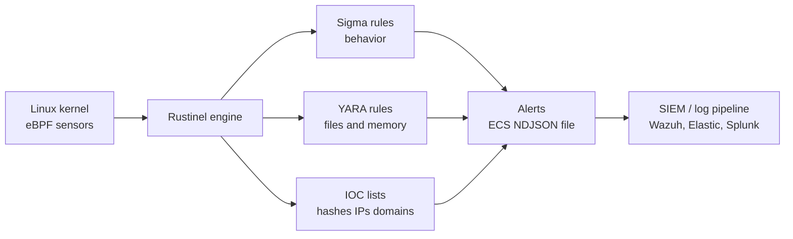

<!--
IMAGE CHECKLIST (add your own screenshots, GitHub does not show this comment)
../assets/images/rustinel/banner.png          (1280x400)
../assets/images/rustinel/architecture.png    (optional own diagram)
../assets/images/rustinel/first-run.png
../assets/images/rustinel/demo-alert.png
../assets/images/rustinel/tmp-exec-alert.png
../assets/images/rustinel/capture-replay.png

VIDEO LINK: when your video is published, replace VIDEO_ID below (and uncomment the block).
-->

<div align="center">
    
# 🦀 Rustinel on Ubuntu: Install, Run, and Write Detection Rules

**A beginner-friendly guide to Rustinel, a lightweight open-source endpoint detection agent written in Rust.**
Install → first alert in minutes → run as a service → write Sigma rules → capture and replay activity.


Part of the **SEC W TOM** security tool installation series.

</div>

## 📺 Video tutorial

<!--
[](https://youtu.be/VIDEO_ID)

▶️ **[Watch on YouTube: Rustinel installation](https://youtu.be/VIDEO_ID)**
-->

Follow the video and this README side by side. Subscribe to [@TOmSec-OG](https://www.youtube.com/@TOmSec-OG) for the full series.

> ⚠️ **Legal and ethical notice.** Run the test activity in this guide **only on machines you own** (your own lab VMs). Education and defensive learning only.

> 🔙 [Back to all tools](../README.md) · Related: [Suricata](../Suricata/) (network detection) · [Wazuh](../Wazuh/) (SIEM)

---

## 📑 Table of Contents

1. [What is Rustinel?](#1-what-is-rustinel)
2. [How it works](#2-how-it-works)
3. [Rustinel vs Suricata vs Wazuh](#3-rustinel-vs-suricata-vs-wazuh)
4. [Requirements](#4-requirements)
5. [Lab setup](#5-lab-setup)
6. [Installation on Ubuntu](#6-installation-on-ubuntu)
7. [First run and first alert](#7-first-run-and-first-alert)
8. [Run Rustinel as a service with a real rule pack](#8-run-rustinel-as-a-service-with-a-real-rule-pack)
9. [Configuration basics](#9-configuration-basics)
10. [Understanding the rules](#10-understanding-the-rules)
11. [Lab 1: Detect execution from /tmp (custom Sigma rule)](#11-lab-1-detect-execution-from-tmp-custom-sigma-rule)
12. [Lab 2: Capture and replay](#12-lab-2-capture-and-replay)
13. [Sending alerts to a SIEM](#13-sending-alerts-to-a-siem)
14. [Active response (dry-run first)](#14-active-response-dry-run-first)
15. [Limitations: know what it is NOT](#15-limitations-know-what-it-is-not)
16. [Everyday commands](#16-everyday-commands)
17. [Troubleshooting](#17-troubleshooting)
18. [Command cheat sheet](#18-command-cheat-sheet)
19. [References](#19-references)

---

## 1. What is Rustinel?

**Rustinel** is an open-source **endpoint detection** tool written in **Rust**. It watches what happens **inside a computer** (programs starting, files changing, network connections, DNS) and checks those events against **detection rules**. When a rule matches, it writes an **alert**.

Think of it as a **CCTV camera inside each computer**: Suricata watches the *road* (network traffic), Rustinel watches *what happens inside the building* (processes and files).

### Highlights

| Feature | Details |
|---|---|
| **Platforms** | Linux (kernel 5.8+, stable), Windows 10/11 and Server 2016+ (stable), macOS 11+ (experimental) |
| **Detections** | **Sigma** rules (behavior), **YARA** rules (files and process memory), **IOC** lists (hashes, IPs, domains, paths) |
| **Telemetry** | eBPF on Linux (process, network, file, DNS). ETW on Windows |
| **Output** | Local alert files in **ECS NDJSON** (one JSON per line) for SIEM tools |
| **Privacy** | No cloud account, the agent sends no data externally |
| **Capture and replay** | Record activity once, replay it later against new rules without special privileges |
| **License** | Apache 2.0 |

> Rustinel is **young and lightweight**. It is a great tool for learning detection engineering, labs, and SIEM pipeline testing. It is **not a replacement for a commercial EDR** (see [Section 15](#15-limitations-know-what-it-is-not)).

---

## 2. How it works



1. **Collect:** sensors report events such as "process X started with command Y".
2. **Detect:** the engine compares events with Sigma, YARA, and IOC content.
3. **Alert:** matches are written to a local JSON alert file.
4. **Ship (optional):** a log shipper or SIEM agent reads that file.

<p align="center">
  
</p>

---

## 3. Rustinel vs Suricata vs Wazuh

| | **Suricata** | **Rustinel** | **Wazuh** |
|---|---|---|---|
| Watches | Network traffic | **Processes, files, DNS on a host** | Logs, file integrity, configuration, vulnerabilities |
| Where it runs | On a network sensor | On each endpoint | Agents plus a central server |
| Detection language | Suricata rules | **Sigma, YARA, IOC** | Wazuh rules (XML) |
| Console / dashboard | No (logs only) | No (alert files only) | **Yes** (dashboard) |
| Best for | Seeing attacks on the wire | Behavior detection on a host | Central monitoring and compliance |

They work **together**: Suricata sees the attack on the network, Rustinel sees the malicious process on the machine, and Wazuh collects both into one place.

---

## 4. Requirements

### ✅ Mandatory (Linux)

| Requirement | Why |
|---|---|
| Linux **kernel 5.8 or newer with BTF** | Rustinel's eBPF sensors need it |
| **Root**, or one of the capabilities `CAP_BPF`, `CAP_PERFMON`, `CAP_NET_ADMIN`, `CAP_SYS_ADMIN` | Loading eBPF programs |
| `curl` and internet access | Downloading the installer and release |
| 64-bit system (x86_64 or arm64) | Official Linux builds are for these |

Ubuntu 22.04 and 24.04 ship kernels newer than 5.8 with BTF enabled by default, so they work well. Check your own machine in the next step.

### 👍 Recommended (lab suggestions)

| Item | Suggestion |
|---|---|
| OS | Ubuntu Server 22.04 or 24.04 LTS |
| CPU / RAM / Disk | 2 vCPU, 2 GB+ RAM, 10 GB+ disk (the agent is lightweight, so this is a comfortable lab size, not an official minimum) |
| Extra | A VM snapshot before you start |

### Check your kernel and BTF

```bash
uname -r                      # kernel version, must be 5.8 or higher
ls -l /sys/kernel/btf/vmlinux # must exist (BTF available)
```

If the second command says "No such file", your kernel has no BTF and Rustinel's Linux sensors will not work.

---

## 5. Lab setup

```
┌──────────────────────────────┐
│  Ubuntu VM                   │
│  • Rustinel (monitored host) │
│  • Terminal for test activity│
└──────────────────────────────┘
   Optional: Wazuh agent on the same VM to collect Rustinel alerts
```

One Ubuntu VM is enough. You will trigger test activity on the same machine and read the alerts.

---

## 6. Installation on Ubuntu

### Step 1: Update the system

```bash
sudo apt update && sudo apt upgrade -y
sudo apt install -y curl
```

### Step 2: Install Rustinel

**Option A: the official installer (fastest)**

```bash
curl -fsSL https://rustinel.io/install.sh | sh
cd rustinel
```

This creates a `rustinel` folder in your current directory containing the binary and default files.

**Option B: inspect first, then run (recommended habit for security tools)**

Piping a script straight from the internet into a shell is convenient but risky. Do it the careful way:

```bash
curl -fsSL https://rustinel.io/install.sh -o install.sh
less install.sh          # read what it does
sh install.sh
cd rustinel
```

**Option C: manual download and signature check**

Download the Linux `.tar.gz` for your CPU (x86_64 or arm64) and the checksums file from the project's **[Releases page](https://github.com/Karib0u/rustinel/releases)**, then verify before extracting:

```bash
sha256sum -c rustinel-<version>-checksums-sha256.txt --ignore-missing
tar -xzf rustinel-<version>-x86_64-unknown-linux-musl.tar.gz
```

Releases also include a signed checksums file (`.minisig`) and build provenance, which the project documents on its release page. Use these if you need to prove the file is genuine.

### Step 3: Confirm the binary

```bash
./rustinel --help
```

> Versions change quickly. Release notes for the 1.9.x line describe the commands used in this guide. If a command behaves differently, check `./rustinel --help` and the [official docs](https://docs.rustinel.io/).

---

## 7. First run and first alert

Rustinel's quickstart ships a **demo rule** so you can see an alert immediately.

**Terminal 1: start Rustinel in the foreground**

```bash
cd rustinel
sudo ./rustinel run
```

Leave it running.

**Terminal 2: trigger the demo rule**

```bash
whoami
```

**Terminal 3 (or after stopping): read the alert**

```bash
ls rustinel/logs/
tail -n 1 rustinel/logs/alerts.json.* | jq .
```

(Adjust the path if you are already inside the `rustinel` folder: `tail -n 1 logs/alerts.json.* | jq .`. Install `jq` with `sudo apt install -y jq` if needed.)

You should see a JSON alert for the `whoami` execution. 🎉

<p align="center">
  
  
</p>

Stop Rustinel with **Ctrl + C**.

> If `sudo ./rustinel run` fails because of a leftover `logs` folder from an earlier install, remove that folder or re-run the installer with `--force` (this was a known first-run issue fixed in newer releases).

---

## 8. Run Rustinel as a service with a real rule pack

The demo rule is only for testing. To install Rustinel as a **service** with a real detection rule pack:

```bash
sudo ./rustinel setup --yes
```

This installs the agent as a service and sets up a rules pack. By default **Linux Essential** rules are enabled.

Check the health of the installation:

```bash
sudo ./rustinel doctor            # runtime health, dropped events, telemetry status
sudo ./rustinel sigma doctor      # which Sigma rules can actually fire on this system
```

Check the service (the unit name can differ by version):

```bash
systemctl list-units | grep -i rustinel
sudo systemctl status rustinel
```

### Rule packs

Official detection content lives in the [`rustinel-rules`](https://github.com/Karib0u/rustinel-rules) repository, grouped in cumulative packs:

| Pack | Idea |
|---|---|
| **Essential** | Core, high-signal detections (on by default for Windows and Linux) |
| **Advanced** | Essential plus more coverage (off by default) |
| **Hunting** | Advanced plus noisier hunting rules (off by default) |

Load **one pack only**, because each higher pack already includes the lower ones. Update your rules with:

```bash
sudo ./rustinel rules update
```

---

## 9. Configuration basics

Rustinel is configured with a **`config.toml`** file in its install folder. You point it at rule folders and tune behavior there.

Rule folders (from the rules repository) follow this pattern:

```
rules/sigma/<os>/     Sigma behavior rules (.yml)
rules/yara/<os>/      YARA rules (.yar)
rules/ioc/<os|common>/ IOC sets (hashes, IPs, domains, path regexes)
```

Your **own rules** can live in separate "local" folders so updates never overwrite them. In `config.toml`, the settings are named `scanner.sigma_local_rules_paths` and `scanner.yara_local_rules_paths`. Example idea:

```toml
[scanner]
sigma_local_rules_paths = ["/home/ubuntu/rustinel-local/sigma"]
yara_local_rules_paths  = ["/home/ubuntu/rustinel-local/yara"]
```

> The exact keys and value format can change between versions. Confirm them in the [configuration docs](https://docs.rustinel.io/) and with `./rustinel doctor` after editing. If a local rule has the **same Sigma ID or YARA name** as a pack rule, your local rule overrides it (with a warning).

After changing the config, restart the service and run `doctor`:

```bash
sudo systemctl restart rustinel
sudo ./rustinel doctor
```

---

## 10. Understanding the rules

### Sigma (behavior rules)

**Sigma** is a vendor-neutral, readable rule format. A Sigma rule describes *what suspicious behavior looks like* (for example "a program started from `/tmp`"). Rustinel uses **Sysmon-style field names** such as `Image` (the program path) and `CommandLine`.

### YARA (file and memory rules)

**YARA** matches **patterns inside files and process memory**, useful for malware families and packed binaries.

### IOC lists

**IOCs** (Indicators of Compromise) are known-bad values: file **hashes**, **IPs**, **domains**, **paths**.

| Rule type | Detects | Example |
|---|---|---|
| Sigma | Behavior | Binary executed from `/tmp` |
| YARA | Content | Known malware string in a file |
| IOC | Known-bad values | Connection to a bad domain |

---

## 11. Lab 1: Detect execution from /tmp (custom Sigma rule)

**Goal:** write your own rule and watch it fire.

Attackers often drop programs into `/tmp` (a world-writable folder) and run them from there. Normal software rarely runs from `/tmp`.

### Step 1: Create a local rules folder

```bash
mkdir -p ~/rustinel-local/sigma
nano ~/rustinel-local/sigma/lab_exec_from_tmp.yml
```

### Step 2: Write the rule

Generate a unique ID first: `uuidgen`, then use it below.

```yaml
title: LAB Process Executed From /tmp
id: 00000000-0000-4000-8000-000000000001   # replace with the output of uuidgen
status: experimental
description: Lab rule that detects a program launched from the /tmp directory
author: SEC W TOM
logsource:
  category: process_creation
  product: linux
detection:
  selection:
    Image|startswith: '/tmp/'
  condition: selection
falsepositives:
  - Installers or build tools that run from /tmp
level: medium
```

### Step 3: Point Rustinel at it and check

Add the folder to `sigma_local_rules_paths` in `config.toml` (see [Section 9](#9-configuration-basics)), restart, then confirm the rule is **loadable and able to fire**:

```bash
sudo systemctl restart rustinel
sudo ./rustinel sigma doctor
```

### Step 4: Trigger it (safe test)

```bash
cp /bin/ls /tmp/ls_test
/tmp/ls_test
```

### Step 5: See the alert

Look in the alerts file (path depends on how you installed; with a portable install it is `rustinel/logs/alerts.json.<date>`):

```bash
sudo grep -h "ls_test" rustinel/logs/alerts.json.* | jq .
```

You should see an alert for your rule. Clean up: `rm /tmp/ls_test`.

<p align="center">
  
</p>

> 💡 Rules only fire when a **sensor** supplies the matching event type. `rustinel sigma doctor` tells you if a rule is inert because nothing feeds its `logsource`.

---

## 12. Lab 2: Capture and replay

A standout Rustinel feature: **record** real activity once, then **replay** it against changed rules, with no root needed for replay. This is perfect for rule testing without re-attacking.

### Record a session

```bash
mkdir -p ~/captures
sudo ./rustinel capture --output ~/captures/session.ndjson
```

While it records, run some activity (for example the `/tmp` test from Lab 1). Stop with **Ctrl + C**. Make the file readable by your user:

```bash
sudo chown -R "$USER" ~/captures
```

### Replay it

```bash
./rustinel replay ~/captures/session.ndjson
```

### Replay with a different config (test new rules safely)

```bash
./rustinel replay ~/captures/session.ndjson --config candidate.toml
```

> Newer releases refuse to overwrite an existing capture or output file, so use a new file name each time.

<p align="center">
  
</p>

**Why it matters:** this is how detection engineers tune rules: capture once, replay many times, and check for false positives before going live.

---

## 13. Sending alerts to a SIEM

Rustinel writes alerts as **ECS NDJSON** files, which Elastic, Splunk, and other pipelines can read. It does not send data anywhere by itself.

**Idea: collect them with a Wazuh agent** (see the [Wazuh guide](../Wazuh/)). On the Rustinel machine, add to the agent's `/var/ossec/etc/ossec.conf`:

```xml
<localfile>
  <log_format>json</log_format>
  <location>/path/to/rustinel/logs/alerts.json.*</location>
</localfile>
```

Replace the path with where your install writes alerts, then restart the agent:

```bash
sudo systemctl restart wazuh-agent
```

> This is a lab idea, **not an official integration**. Wazuh will collect the JSON lines, but you will need a custom Wazuh rule to turn specific Rustinel fields into dashboard alerts. Check your alert's field names first with `jq`.

---

## 14. Active response (dry-run first)

Rustinel can optionally **respond** to detections. Its configuration has a `[response]` section:

```toml
[response]
enabled = true
prevention_enabled = false   # false = dry-run (log what it WOULD do), true = prevention
```

**Always start in dry-run mode** (`prevention_enabled = false`). In dry-run, Rustinel logs the action it would take without doing it, so you can check for false positives before allowing real blocking. Default trusted paths (like `/usr/bin/`) are allowlisted so system programs are not touched.

---

## 15. Limitations: know what it is NOT

The project is honest about its limits. Good analysts should be too.

| Limitation | What it means |
|---|---|
| **Not a full commercial EDR** | No anti-tamper, no kernel self-protection, no pre-execution blocking, no management console |
| **No hashes in process events** | Sigma rules that depend on file hashes will never fire |
| **Short-lived processes** | The command line can be lost for very quick processes |
| **No correlation rules** | No aggregation or "N events in T seconds" logic in Sigma rules |
| **Dropped events under heavy load** | There is no backpressure, so a burst of events can be lost |
| **Inert rules** | A rule with no matching sensor silently does nothing (use `sigma doctor`) |
| **Young project** | Features and config keys change between versions |

**Use Rustinel for:** labs, learning detection engineering, SIEM pipeline testing, and lightweight monitoring. **Do not** rely on it as your only protection for production systems.

---

## 16. Everyday commands

| Task | Command |
|---|---|
| Run in the foreground (testing) | `sudo ./rustinel run` |
| Install as a service with rules | `sudo ./rustinel setup --yes` |
| Check runtime health | `sudo ./rustinel doctor` |
| Check which Sigma rules can fire | `sudo ./rustinel sigma doctor` |
| Update Rustinel | `sudo ./rustinel update` |
| Update rules | `sudo ./rustinel rules update` |
| Record activity | `sudo ./rustinel capture --output ~/captures/new.ndjson` |
| Replay activity | `./rustinel replay ~/captures/new.ndjson` |
| Replay with another config | `./rustinel replay ~/captures/new.ndjson --config candidate.toml` |
| View latest alert | `tail -n 1 logs/alerts.json.* \| jq .` |
| Help | `./rustinel --help` |

After upgrading the binary, **restart the service and run `doctor`**.

---

## 17. Troubleshooting

| Symptom | Likely cause | Fix |
|---|---|---|
| Fails to start or load eBPF | Kernel older than 5.8 or no BTF | `uname -r`, `ls /sys/kernel/btf/vmlinux`. Use a newer kernel or Ubuntu LTS |
| Permission denied | Not root | Use `sudo`, or grant the needed capabilities |
| `sudo ./rustinel run` fails on first run | Leftover `logs` folder | Remove the folder or re-run the installer with `--force` |
| No alerts at all | Rules not loaded, or no matching sensor | `./rustinel doctor`, `./rustinel sigma doctor` |
| Custom rule never fires | Wrong path, duplicate ID, or inert logsource | Check `sigma_local_rules_paths`, run `sigma doctor` |
| Hash rule never fires | Process events carry no hashes | Use a path or behavior rule instead |
| Missing command line in an alert | Very short-lived process | Known limitation |
| Alerts missing during a burst | Events dropped under load | Check `doctor` for dropped-event counts, reduce load |
| `capture` or `replay --output` refuses to run | Output file already exists | Use a new file name |
| Service not found | Different unit name | `systemctl list-units \| grep -i rustinel` |

---

## 18. Command cheat sheet

```bash
# --- Requirements check ---
uname -r && ls -l /sys/kernel/btf/vmlinux

# --- Install (inspect first) ---
curl -fsSL https://rustinel.io/install.sh -o install.sh && less install.sh && sh install.sh
cd rustinel

# --- First alert ---
sudo ./rustinel run          # terminal 1
whoami                       # terminal 2 (triggers demo rule)
tail -n 1 logs/alerts.json.* | jq .

# --- Service + rules ---
sudo ./rustinel setup --yes
sudo ./rustinel doctor
sudo ./rustinel sigma doctor
sudo ./rustinel rules update

# --- Capture and replay ---
sudo ./rustinel capture --output ~/captures/session.ndjson
./rustinel replay ~/captures/session.ndjson
```

---

## 19. References

- Rustinel project: <https://github.com/Karib0u/rustinel>
- Rustinel documentation: <https://docs.rustinel.io/>
- Official detection rules: <https://github.com/Karib0u/rustinel-rules>
- Sigma rules format: <https://sigmahq.io/>
- YARA: <https://virustotal.github.io/yara/>

> Rustinel is a fast-moving project. This guide follows the 1.9.x documentation. If something differs in your version, follow the official docs and `./rustinel --help`.

---

<div align="center">

### ⭐ If this guide helped you, star the repo and subscribe to **SEC W TOM**.

📺 [Channel @TOmSec-OG](https://www.youtube.com/@TOmSec-OG) · 💻 [GitHub THeOLdMAn48](https://github.com/THeOLdMAn48/)

**Learn - Secure - Grow**

*Educational use only. Use responsibly and legally.*

</div>
