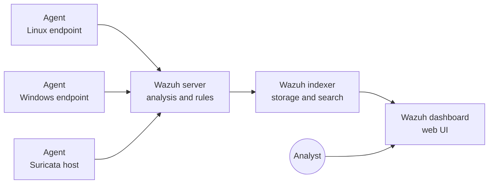

<!--
IMAGE CHECKLIST (add your own screenshots, GitHub does not show this comment)
../assets/images/wazuh/banner.png            (1280x400)
../assets/images/wazuh/architecture.png      (optional, if you want your own diagram)
../assets/images/wazuh/dashboard-home.png
../assets/images/wazuh/install-summary.png   (terminal output with the admin password blurred)
../assets/images/wazuh/deploy-agent.png
../assets/images/wazuh/agents-active.png
../assets/images/wazuh/fim-alert.png
../assets/images/wazuh/ssh-alert.png
../assets/images/wazuh/suricata-alerts.png
-->

<div align="center">


# 🛡️ Wazuh on Ubuntu: Install, Connect Agents, and Detect Threats

**A beginner-friendly, copy-paste guide to the Wazuh open-source SIEM and XDR platform.**
Install the server → open the dashboard → connect agents → run hands-on detection labs → write custom rules.


Part of the **SEC W TOM** security tool installation series.

</div>

## 📺 Watch the video tutorial

[](https://youtu.be/6AjIGnq5ZE4)

▶️ **[Watch on YouTube: Wazuh installation](https://youtu.be/6AjIGnq5ZE4)**. Follow the video and this README side by side. Subscribe to [@TOmSec-OG](https://www.youtube.com/@TOmSec-OG) for the next tools in the series.

> ⚠️ **Legal and ethical notice.** Run the test activity in this guide **only on machines you own** (your own lab VMs). This guide is for education and defensive learning.

> 🔙 [Back to all tools](../README.md) · Related guide: [Suricata](../Suricata/) (Wazuh can read Suricata alerts, see [Section 10](#10-lab-4-see-suricata-alerts-in-wazuh))

---

## 📑 Table of Contents

1. [What is Wazuh?](#1-what-is-wazuh)
2. [How Wazuh is built (architecture)](#2-how-wazuh-is-built-architecture)
3. [Requirements](#3-requirements)
4. [Lab setup](#4-lab-setup)
5. [Install the Wazuh server (all-in-one)](#5-install-the-wazuh-server-all-in-one)
6. [Open the dashboard](#6-open-the-dashboard)
7. [Deploy a Wazuh agent](#7-deploy-a-wazuh-agent)
8. [Lab 1: File Integrity Monitoring](#8-lab-1-file-integrity-monitoring)
9. [Lab 2 and 3: SSH failures and sudo activity](#9-lab-2-and-3-ssh-failures-and-sudo-activity)
10. [Lab 4: See Suricata alerts in Wazuh](#10-lab-4-see-suricata-alerts-in-wazuh)
11. [Writing custom rules](#11-writing-custom-rules)
12. [Important files, folders, and ports](#12-important-files-folders-and-ports)
13. [Everyday commands](#13-everyday-commands)
14. [After installation: good habits](#14-after-installation-good-habits)
15. [Troubleshooting](#15-troubleshooting)
16. [Uninstall](#16-uninstall)
17. [Command cheat sheet](#17-command-cheat-sheet)
18. [References](#18-references)

---

## 1. What is Wazuh?

**Wazuh** is a free, open-source security platform that combines **SIEM** (Security Information and Event Management) and **XDR** (Extended Detection and Response) features. You install small **agents** on your computers and servers. The agents send security data to a central Wazuh server, which analyzes it with rules and shows alerts in a web dashboard.

Think of it as a **security camera control room**: the agents are cameras on every machine, and the dashboard is the monitor wall where an analyst watches for anything suspicious.

### What Wazuh can do

| Capability | What it means |
|---|---|
| **Log analysis** | Reads system and application logs and raises alerts using rules |
| **File Integrity Monitoring (FIM)** | Alerts when important files are added, changed, or deleted |
| **Security Configuration Assessment (SCA)** | Checks systems against hardening benchmarks |
| **Vulnerability detection** | Matches installed software against known vulnerabilities |
| **Intrusion and malware detection** | Spots rootkit behavior and suspicious activity |
| **Active response** | Can run an automatic action, such as blocking an IP |
| **Regulatory compliance** | Maps alerts to frameworks such as PCI DSS and GDPR |
| **Integrations** | Works with tools like Suricata, VirusTotal, and SOAR platforms |

### Why SOC analysts use Wazuh

One place to see endpoint and network alerts, free to use, huge rule library, scalable from a home lab to large networks, and it feeds the rest of a SOC pipeline (case management and automation tools).

---

## 2. How Wazuh is built (architecture)

Wazuh has **four main parts**:

| Component | Job |
|---|---|
| **Wazuh agent** | Runs on each monitored machine and collects events (logs, file changes, processes) |
| **Wazuh server** (manager) | Receives agent data, decodes events, and matches them with rules to create alerts |
| **Wazuh indexer** | Stores and indexes alerts so you can search them fast |
| **Wazuh dashboard** | The web interface for viewing alerts, agents, and reports |



In this guide we use the **all-in-one** install, which puts the server, indexer, and dashboard on **one machine**. This is perfect for learning and small labs. Larger networks use a **distributed** deployment with multiple nodes.

<p align="center">
  
</p>

---

## 3. Requirements

### ✅ Mandatory

| Requirement | Why |
|---|---|
| 64-bit Linux host (x86_64/AMD64 or AARCH64/ARM64) | Wazuh central components run on Linux |
| A supported OS (Ubuntu 16.04, 18.04, 20.04, 22.04, or 24.04 for this guide) | Official support list for the installer |
| `sudo` / root access | Installing packages and services |
| Internet access | The installer downloads packages |
| Free ports (see [Section 12](#12-important-files-folders-and-ports)) | Components need to listen on them |

### 👍 Recommended hardware (official quickstart sizing)

For the all-in-one install, up to 100 agents, with 90 days of alert storage:

| Agents | CPU | RAM | Storage (90 days) |
|---|---|---|---|
| 1-25 | 4 vCPU | 8 GiB | 50 GB |
| 26-50 | 8 vCPU | 8 GiB | 100 GB |
| 51-100 | 8 vCPU | 8 GiB | 200 GB |

For a small home lab (1 to 3 agents), **4 vCPU, 8 GB RAM, and 50 GB disk** is a good starting point. Below this, the indexer and dashboard can be slow or fail to start. Larger environments should use a distributed deployment (see the official docs).

> 💡 Wazuh is heavier than Suricata. Give the VM enough RAM *before* you install, and take a **VM snapshot** first.

---

## 4. Lab setup

```
┌────────────────────┐     ┌───────────────────────────────┐
│  Wazuh Server VM   │ ◄── │  Agent VM (Ubuntu)            │
│  Ubuntu Server     │     │  Wazuh agent + test activity  │
│  192.168.56.10     │     │  192.168.56.20                │
│  server+indexer+   │     └───────────────────────────────┘
│  dashboard         │ ◄── Windows VM or Suricata host (optional agents)
└────────────────────┘
       Host-only or NAT network (192.168.56.0/24)
```

Replace the example IPs with yours. Use a **static IP** for the Wazuh server so agents always find it.

Find your IP and interface:

```bash
ip -br a
```

---

## 5. Install the Wazuh server (all-in-one)

Run these on the **Wazuh server VM**.

### Step 1: Update the system

```bash
sudo apt update && sudo apt upgrade -y
sudo apt install -y curl
```

### Step 2: Run the Wazuh installation assistant

This single command downloads and runs the official installer, which installs the **server, indexer, and dashboard**:

```bash
curl -sO https://packages.wazuh.com/4.14/wazuh-install.sh && sudo bash ./wazuh-install.sh -a
```

- `-a` means **all-in-one** (everything on this machine).
- It takes several minutes. Do not close the terminal.
- The installer checks hardware and open ports first and tells you if something is wrong.

When it finishes you will see **"Installation finished"** and a **Summary** like this:

```
INFO: --- Summary ---
INFO: You can access the web interface https://<WAZUH_DASHBOARD_IP_ADDRESS>
    User: admin
    Password: <ADMIN_PASSWORD>
INFO: Installation finished.
```

> 🔐 **Copy the admin password now** and store it safely (for example in a password manager).

<p align="center">
  
</p>

### Step 3: Get the passwords again later (if you lost them)

The installer saves all generated passwords in `wazuh-install-files.tar` in the folder where you ran it:

```bash
sudo tar -O -xvf wazuh-install-files.tar wazuh-install-files/wazuh-passwords.txt
```

### Step 4: Verify the services

```bash
sudo systemctl status wazuh-manager
sudo systemctl status wazuh-indexer
sudo systemctl status wazuh-dashboard
```

All three should show **active (running)**. If a service is stuck, check [Troubleshooting](#15-troubleshooting).

> 💡 **Low on RAM?** The installer has an option to ignore the hardware check (`-i`). Use it only in a throwaway lab and expect slow performance. It is not a supported production setup.

---

## 6. Open the dashboard

1. On any computer that can reach the server, open a browser and go to:

   ```
   https://<WAZUH_SERVER_IP>
   ```

2. Your browser will warn about the certificate. This is **expected** because Wazuh creates a self-signed certificate. Choose **Advanced → Proceed** (or configure a trusted certificate later).
3. Log in with user **`admin`** and the password from the installer summary.

If the page does not load, allow HTTPS through the firewall:

```bash
sudo ufw status
sudo ufw allow 443/tcp
```

<p align="center">
  
</p>

At first you will see **no agents** yet. Let's add one.

---

## 7. Deploy a Wazuh agent

Agents are installed on the machines you want to monitor.

### Method A (recommended): the dashboard wizard

The dashboard generates the **exact commands for your server and version**, so this is the safest method.

1. In the dashboard, go to **Agents → Deploy new agent** (menu wording may vary slightly by version).
2. Choose the **operating system** of the endpoint (for example `DEB amd64` for Ubuntu, or `MSI` for Windows).
3. Enter the **Wazuh server address** (the server's IP).
4. Optionally give the agent a **name** (and group).
5. Copy the generated command and run it **on the endpoint**.
6. Start the agent with the commands shown by the wizard.

<p align="center">
  
</p>

### Method B: Ubuntu / Debian agent with APT (reference)

This is the documented repository method. **If the wizard shows different commands for your version, trust the wizard.**

```bash
# 1) Add the Wazuh repository key and source
curl -s https://packages.wazuh.com/key/GPG-KEY-WAZUH | sudo gpg --no-default-keyring --keyring gnupg-ring:/usr/share/keyrings/wazuh.gpg --import && sudo chmod 644 /usr/share/keyrings/wazuh.gpg
echo "deb [signed-by=/usr/share/keyrings/wazuh.gpg] https://packages.wazuh.com/4.x/apt/ stable main" | sudo tee /etc/apt/sources.list.d/wazuh.list
sudo apt-get update

# 2) Install the agent and point it at your server
sudo WAZUH_MANAGER="192.168.56.10" apt-get install wazuh-agent

# 3) Start it and enable at boot
sudo systemctl daemon-reload
sudo systemctl enable --now wazuh-agent
```

> ⚠️ **Version rule:** the agent version must **not be newer** than the Wazuh server version. The `4.x` repository can offer a newer 4.x release than your server. Check with `apt-cache policy wazuh-agent`, and if needed install the matching version, for example `sudo WAZUH_MANAGER="192.168.56.10" apt-get install wazuh-agent=4.14.<patch>-1` (use your server's version).

### Windows agent

Use the dashboard wizard, choose **Windows**, copy the PowerShell commands it generates, run them in an **Administrator PowerShell**, then start the `WazuhSvc` service as the wizard shows.

### Verify the agent

On the agent machine:

```bash
sudo systemctl status wazuh-agent
sudo tail -n 20 /var/ossec/logs/ossec.log
```

Look for lines saying the agent **connected to the server**.

On the Wazuh server:

```bash
sudo /var/ossec/bin/agent_control -l
```

In the dashboard, open **Agents**. Your agent should show as **Active**.

<p align="center">
  
</p>

---

## 8. Lab 1: File Integrity Monitoring

**Goal:** get an alert when a file in a watched folder changes.

On the **agent** machine, create a test folder:

```bash
sudo mkdir -p /root/fim-test
```

Edit the agent config:

```bash
sudo nano /var/ossec/etc/ossec.conf
```

Inside the `<syscheck>` section add a line to watch the folder in real time:

```xml
<syscheck>
  <directories check_all="yes" realtime="yes">/root/fim-test</directories>
</syscheck>
```

(If a `<syscheck>` block already exists, add only the `<directories ...>` line inside it.) Restart the agent:

```bash
sudo systemctl restart wazuh-agent
```

**Trigger events:**

```bash
sudo touch /root/fim-test/secret.txt            # file added
echo "changed" | sudo tee /root/fim-test/secret.txt   # file modified
sudo rm /root/fim-test/secret.txt               # file deleted
```

**See the alerts:** dashboard → **File Integrity Monitoring** (or **Threat Hunting / Events**) → filter by your agent. You should see added, modified, and deleted events for the file.

<p align="center">
  
</p>

**Why it matters:** attackers change system files, web shells, and config files. FIM shows exactly what changed and when.

---

## 9. Lab 2 and 3: SSH failures and sudo activity

### Lab 2: failed SSH logins

**Goal:** see authentication failures.

On the agent machine, make sure SSH is installed: `sudo apt install -y openssh-server`. From **another lab machine**, try to log in with a **wrong password** a few times:

```bash
ssh wronguser@192.168.56.20
```

In the dashboard open **Threat Hunting / Events** and search for `sshd` or `authentication failed`. You will see alerts for the failed attempts. Many failures in a short time from one source IP is a classic **brute-force** sign.

### Lab 3: privilege escalation with `sudo`

On the agent machine, run a command with `sudo`:

```bash
sudo ls /root
```

Search the dashboard for `sudo`. Wazuh records privileged command use, which helps you audit who did what with admin rights.

<p align="center">
  
</p>

> Use only your own lab machines and test accounts.

---

## 10. Lab 4: See Suricata alerts in Wazuh

This links this series together: **Suricata detects in the network, Wazuh collects and shows the alerts.**

1. Install Suricata with the [Suricata guide](../Suricata/) on a machine.
2. Install a **Wazuh agent on that same machine** (Section 7).
3. On the Suricata machine, tell the agent to read Suricata's JSON log. Edit `/var/ossec/etc/ossec.conf` and add inside the main `<ossec_config>` block:

```xml
<localfile>
  <log_format>json</log_format>
  <location>/var/log/suricata/eve.json</location>
</localfile>
```

4. Restart the agent:

```bash
sudo systemctl restart wazuh-agent
```

5. Generate a Suricata alert, for example:

```bash
curl http://testmynids.org/uid/index.html
```

6. In the Wazuh dashboard, search for `suricata` in **Threat Hunting / Events**. You should see the Suricata alert, now in your SIEM.

<p align="center">
  
</p>

> If nothing appears, confirm `/var/log/suricata/eve.json` is being written and that the agent can read it (the agent runs as root by default).

---

## 11. Writing custom rules

Wazuh ships thousands of rules. You add your own in a separate file so updates never overwrite them.

**Custom rules file (on the Wazuh server):**

```bash
sudo nano /var/ossec/etc/rules/local_rules.xml
```

**Example:** raise a high-severity alert when the same IP fails SSH authentication 6 times in 60 seconds.

```xml
<group name="local,syslog,sshd,">
  <rule id="100100" level="10" frequency="6" timeframe="60">
    <if_matched_sid>5760</if_matched_sid>
    <same_source_ip />
    <description>LAB: Possible SSH brute force (6 failures in 60 seconds)</description>
  </rule>
</group>
```

How to read it:

| Part | Meaning |
|---|---|
| `id="100100"` | Your own rule ID. **Use 100000 or higher** for custom rules |
| `level="10"` | Severity from 0 (ignore) to 15 (critical) |
| `frequency` / `timeframe` | Fire after N matches within T seconds |
| `if_matched_sid` | The existing rule this one builds on (SSH authentication failed) |
| `same_source_ip` | Count only events from the same source IP |
| `description` | The text analysts see |

### Test a rule before using it: `wazuh-logtest`

```bash
sudo /var/ossec/bin/wazuh-logtest
```

Paste a sample log line, and it shows which decoder and rule matched. Fix mistakes here, not in production.

### Apply the rule

```bash
sudo systemctl restart wazuh-manager
```

Then repeat the failed SSH logins from Lab 2 and look for your rule ID `100100` in the dashboard.

> Rule IDs and decoders can differ between versions. Use `wazuh-logtest` to confirm which rule matches your log lines before you build on them.

---

## 12. Important files, folders, and ports

### Files and folders (on the Wazuh server)

| Path | What it is |
|---|---|
| `/var/ossec/etc/ossec.conf` | Main manager configuration |
| `/var/ossec/etc/rules/local_rules.xml` | **Your custom rules** |
| `/var/ossec/etc/decoders/local_decoder.xml` | Your custom decoders |
| `/var/ossec/logs/ossec.log` | Manager log (first place to look for errors) |
| `/var/ossec/logs/alerts/alerts.json` | Alerts in JSON |
| `/var/ossec/bin/` | Wazuh tools (`agent_control`, `wazuh-logtest`) |
| `wazuh-install-files.tar` | Passwords and certificates created by the installer (keep it safe) |

### On the agent

| Path | What it is |
|---|---|
| `/var/ossec/etc/ossec.conf` | Agent configuration |
| `/var/ossec/logs/ossec.log` | Agent log |

### Default ports (check the official docs for your version)

| Port | Used for |
|---|---|
| **443/tcp** | Wazuh dashboard (HTTPS) |
| **1514/tcp** | Agent to server communication |
| **1515/tcp** | Agent enrollment |
| **55000/tcp** | Wazuh server API |
| **9200/tcp** | Wazuh indexer |

For a lab you mainly need **443** (browser to server) and **1514 / 1515** (agents to server) open on the server.

```bash
sudo ufw allow 443/tcp
sudo ufw allow 1514/tcp
sudo ufw allow 1515/tcp
```

---

## 13. Everyday commands

| Task | Command |
|---|---|
| Check server services | `sudo systemctl status wazuh-manager wazuh-indexer wazuh-dashboard` |
| Restart the manager | `sudo systemctl restart wazuh-manager` |
| Restart the dashboard | `sudo systemctl restart wazuh-dashboard` |
| List agents | `sudo /var/ossec/bin/agent_control -l` |
| Test rules and decoders | `sudo /var/ossec/bin/wazuh-logtest` |
| Watch manager log | `sudo tail -f /var/ossec/logs/ossec.log` |
| Watch alerts live | `sudo tail -f /var/ossec/logs/alerts/alerts.json` |
| Agent status | `sudo systemctl status wazuh-agent` |
| Restart the agent | `sudo systemctl restart wazuh-agent` |
| Show passwords again | `sudo tar -O -xvf wazuh-install-files.tar wazuh-install-files/wazuh-passwords.txt` |

---

## 14. After installation: good habits

- 🔐 **Change or protect the admin password** and never expose the dashboard to the public internet.
- 📸 **Snapshot the VM** after a working install.
- 🔒 **Stop accidental upgrades:** the official docs recommend disabling the Wazuh repository after installing, so a routine `apt upgrade` does not move components to an unplanned version. On Ubuntu/Debian:

  ```bash
  sudo sed -i "s/^deb /#deb /" /etc/apt/sources.list.d/wazuh.list
  sudo apt update
  ```

  Re-enable it only when you deliberately plan an upgrade, and follow the official upgrade guide.
- 🕒 **Keep time in sync** on server and agents (correct time makes alerts line up).
- 💾 **Watch disk space.** Alerts accumulate quickly.
- 🌐 **Use a static IP** for the server.

---

## 15. Troubleshooting

| Symptom | Likely cause | Fix |
|---|---|---|
| Installer stops with a hardware or port error | Not enough RAM/CPU, or a port already in use | Add resources, or free the port (`sudo ss -tulpn`) |
| Dashboard says it is **not ready yet** | Services still starting | Wait a few minutes, then `sudo systemctl restart wazuh-dashboard` |
| Dashboard does not open | Firewall, wrong IP, or service down | `sudo ufw allow 443/tcp`, confirm the IP, check the dashboard service |
| Browser shows a certificate warning | Self-signed certificate | Expected. Accept the exception |
| Forgot admin password | Not saved | Use the `tar` command in [Step 3](#step-3-get-the-passwords-again-later-if-you-lost-them) |
| Agent stays **Disconnected** | Wrong server IP, blocked ports 1514/1515, or version mismatch | Fix `<address>` in the agent's `ossec.conf`, open the ports, match versions |
| Agent never appears | Enrollment failed | Check `sudo tail -n 50 /var/ossec/logs/ossec.log` on the agent |
| No Suricata alerts in Wazuh | Missing `<localfile>` block or no read access | Re-check Section 10 and that `eve.json` is growing |
| Custom rule never fires | XML mistake or wrong parent rule | Test with `wazuh-logtest`, check `ossec.log` for rule errors |
| Services crash or are slow | Low RAM or disk | Increase VM resources, free disk space |

Handy debugging:

```bash
sudo journalctl -u wazuh-manager -n 50 --no-pager
sudo journalctl -u wazuh-indexer -n 50 --no-pager
sudo journalctl -u wazuh-dashboard -n 50 --no-pager
sudo tail -n 50 /var/ossec/logs/ossec.log
```

---

## 16. Uninstall

To remove the **central components** (server, indexer, dashboard), run the installation assistant with the uninstall option:

```bash
sudo bash ./wazuh-install.sh -u
```

To remove an **agent** from an Ubuntu endpoint:

```bash
sudo systemctl stop wazuh-agent
sudo apt-get remove --purge wazuh-agent -y
```

---

## 17. Command cheat sheet

```bash
# --- Install server (all-in-one) ---
curl -sO https://packages.wazuh.com/4.14/wazuh-install.sh && sudo bash ./wazuh-install.sh -a

# --- Get passwords ---
sudo tar -O -xvf wazuh-install-files.tar wazuh-install-files/wazuh-passwords.txt

# --- Check services ---
sudo systemctl status wazuh-manager wazuh-indexer wazuh-dashboard

# --- Agent (Ubuntu, reference) ---
sudo WAZUH_MANAGER="SERVER_IP" apt-get install wazuh-agent
sudo systemctl enable --now wazuh-agent

# --- Agents and testing ---
sudo /var/ossec/bin/agent_control -l
sudo /var/ossec/bin/wazuh-logtest

# --- Logs ---
sudo tail -f /var/ossec/logs/ossec.log
sudo tail -f /var/ossec/logs/alerts/alerts.json

# --- Uninstall server components ---
sudo bash ./wazuh-install.sh -u
```

---

## 18. References

- Wazuh documentation: <https://documentation.wazuh.com/current/>
- Quickstart: <https://documentation.wazuh.com/current/quickstart.html>
- Wazuh agent installation guide: <https://documentation.wazuh.com/current/installation-guide/wazuh-agent/index.html>
- Wazuh ruleset and custom rules: <https://documentation.wazuh.com/current/user-manual/ruleset/index.html>

> Wazuh versions change often. This guide targets **Wazuh 4.14**. If a command differs in your version, follow the official docs.

---

<div align="center">

### ⭐ If this guide helped you, star the repo and subscribe to **SEC W TOM**.

📺 [Watch the Wazuh video](https://youtu.be/6AjIGnq5ZE4) · 📺 [Channel @TOmSec-OG](https://www.youtube.com/@TOmSec-OG) · 💻 [GitHub THeOLdMAn48](https://github.com/THeOLdMAn48/)

**Learn - Secure - Grow**

*Educational use only. Use responsibly and legally.*

</div>
