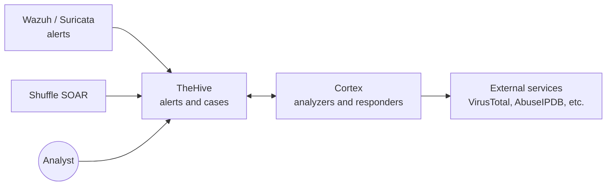

<!--
IMAGE CHECKLIST (add your own screenshots, GitHub does not show this comment)
../Images/thehive.png                 (tool logo, already in your repo)
../Images/cortex.png                  (Cortex logo)
../Images/thehive/banner.png          (1280x400, optional)
../Images/thehive/install-script-menu.png
../Images/thehive/login.png
../Images/thehive/case-view.png
../Images/thehive/cortex-server-added.png
../Images/thehive/analyzer-report.png
../Images/cortex/first-start.png
../Images/cortex/analyzers-enabled.png

VIDEO LINK: when your video is published, replace VIDEO_ID below and uncomment the block.
-->

<div align="center">

 &nbsp;&nbsp;&nbsp; 

# 🐝 TheHive & Cortex on Ubuntu: Install, Connect, and Investigate

**A beginner-friendly guide to setting up an open-source incident response platform (TheHive) and its analysis engine (Cortex).**
Install → first login → connect Cortex → turn an alert into a case → analyze observables.


Part of the **SEC W TOM** security tool installation series.

</div>

## 📺 Video tutorial

<!--
[](https://youtu.be/VIDEO_ID)

▶️ **[Watch on YouTube: TheHive & Cortex installation](https://youtu.be/VIDEO_ID)**
-->

Follow the video and this README side by side. Subscribe to [@TOmSec-OG](https://www.youtube.com/@TOmSec-OG) for the full series.

> ⚠️ **Legal and ethical notice.** Use only your own lab systems and test data. This guide is for education and defensive learning.

> 🔙 [Back to all tools](../README.md) · Related: [Wazuh](../Wazuh/wazuh-readme.md) · [Suricata](../Suricata/Suricata-README.md) · [Rustinel](../Rustinel/rust-readme.md)

---

## 📑 Table of Contents

1. [What are TheHive and Cortex?](#1-what-are-thehive-and-cortex)
2. [How they work together](#2-how-they-work-together)
3. [Key terms](#3-key-terms)
4. [Licensing: read this first](#4-licensing-read-this-first)
5. [Requirements](#5-requirements)
6. [Lab setup](#6-lab-setup)
7. [Install TheHive](#7-install-thehive)
8. [TheHive first login](#8-thehive-first-login)
9. [Install Cortex](#9-install-cortex)
10. [Cortex first start](#10-cortex-first-start)
11. [Connect TheHive to Cortex](#11-connect-thehive-to-cortex)
12. [Lab: alert → case → analyze an observable](#12-lab-alert--case--analyze-an-observable)
13. [Secure your installation](#13-secure-your-installation)
14. [Important files, services, and ports](#14-important-files-services-and-ports)
15. [Troubleshooting](#15-troubleshooting)
16. [Command cheat sheet](#16-command-cheat-sheet)
17. [References](#17-references)

---

## 1. What are TheHive and Cortex?

Think of a **hospital**:

- **TheHive** is the **patient file system**. Every incident gets a case file where the team records tasks, notes, and what happened.
- **Cortex** is the **lab**. You send it a sample (an IP address, a domain, a file hash) and it runs tests and returns a report.

Both are made by StrangeBee and are used in SOC teams.

| | **TheHive** | **Cortex** |
|---|---|---|
| Type | Security Incident Response Platform (SIRP) | Observable analysis and response engine |
| Job | Receive alerts, manage cases, assign tasks, write findings | Run **analyzers** (look things up) and **responders** (take actions) |
| Used by | SOC analysts and incident responders | The same analysts, through TheHive or directly |
| Web port (typical) | 9000 | 9001 |

### Why a SOC analyst uses them

- A single place to track every incident from alert to closure
- Teamwork: assign tasks, comment, share findings
- One click to ask "is this IP or hash known to be bad?" through Cortex analyzers
- Fits the pipeline you see in this series: **Suricata / Wazuh detect → Shuffle automates → TheHive manages → Cortex enriches**

---

## 2. How they work together



### What gets installed

| Component | Role | Notes |
|---|---|---|
| **TheHive** | Main application and web UI | Needs Java 17 |
| **Apache Cassandra** | TheHive's database | Needs Java 11 |
| **Elasticsearch** (or OpenSearch) | Search index | Used by TheHive and by Cortex |
| **Cortex** | Analysis engine | Needs its own Elasticsearch 8.x |
| **Analyzers / Responders** | Small modules that do the lookups and actions | Run as Docker images or directly on the host |

> 💡 **TheHive and Cortex should use separate Elasticsearch instances.** The official docs do not recommend sharing one. The easiest way in a lab is to install them on **two separate VMs**.

---

## 3. Key terms

| Term | Meaning |
|---|---|
| **Alert** | An incoming warning from a tool (SIEM, IDS). Not yet a case |
| **Case** | An incident being investigated, with tasks, notes, and observables |
| **Task** | A to-do step inside a case |
| **Observable** | A piece of evidence: IP, domain, URL, file hash, email address |
| **Analyzer** | A Cortex module that **looks up** an observable (reputation, WHOIS, scan results) |
| **Responder** | A Cortex module that **takes an action** (block, notify, create a ticket) |
| **Organisation** | A team workspace inside TheHive or Cortex |
| **Profile / Role** | What a user is allowed to do |

---

## 4. Licensing: read this first

⚠️ **TheHive 6 needs a license**, and this catches many beginners.

- A fresh install includes a **14-day Platinum trial license**. During the trial you can create up to **2 organisations** and **5 users**.
- After the trial, TheHive goes **read-only** until you activate a license.
- StrangeBee offers a **free Community license**, but you must **request it** through their licensing page, then activate it in TheHive.
- Cortex does not have this licensing step.

**Do this before recording or building a lab:** request the Community license early, and follow the official pages:
[About licenses](https://docs.strangebee.com/thehive/installation/licenses/about-licenses/) (it links to "Request a Community License" and "Activate or Update a License").

---

## 5. Requirements

### ✅ Mandatory

| Item | TheHive | Cortex |
|---|---|---|
| OS | Ubuntu 20.04, 22.04, or 24.04 LTS (also Debian 11/12/13, RHEL 8.5/9.3, Rocky 9.4, Fedora 35/37) | Ubuntu **20.04** LTS (also Debian 11/12/13, RHEL 8, Fedora 35). Other versions are not officially tested |
| Access | `sudo` | `sudo` |
| Internet | Yes (packages and installer) | Yes |
| Java | 17 for TheHive, 11 for Cassandra (both installed side by side) | Amazon Corretto 11 or higher |
| Database / index | Cassandra 4.0.x to 4.1.x, Elasticsearch 7.11.x to 9.5.x (or OpenSearch) | Elasticsearch **8.x** (dedicated) |
| Docker (optional) | Only for the Docker Compose method | Recommended to run analyzers and responders as Docker images |

> The official Cortex requirements list Ubuntu 20.04 only, and 20.04 is old. Newer Ubuntu releases may work, but they are **not officially listed**. If you want zero surprises for Cortex, use Ubuntu 20.04 or use the Docker-based analyzer option, and always check the current [system requirements](https://docs.strangebee.com/cortex/installation-and-configuration/system-requirements/).

### 👍 Recommended hardware (official sizing, use as a guide)

| Setup | RAM | vCPU | Notes |
|---|---|---|---|
| **Lab / testing** (Docker Compose "Testing" profile) | 8 GB | 4 | Good starting point per VM |
| Production #1 | 16 GB | 4 | Standard production |
| Production #2 | 32 GB | 8 | High performance |
| Cortex + Elasticsearch on one machine | 16 GB | 8 | Official Cortex sizing |
| Disk | 100 GB | | For most use cases (150 GB for heavy use) |

For a home lab, **one VM for TheHive (8 GB RAM, 4 vCPU)** and **one VM for Cortex (8 GB RAM, 4 vCPU)** is a sensible start. Use less disk if you are only testing, but expect to grow.

### Ports

| Port | Used for |
|---|---|
| **9000/tcp** | TheHive web UI (typical default, the installer shows the exact URL) |
| **9001/tcp** | Cortex web UI |
| **9042/tcp** | Cassandra |
| **9200/tcp** | Elasticsearch |
| **80 / 443** | Nginx, if you use the Docker Compose method |

---

## 6. Lab setup

```
┌─────────────────────────┐        ┌─────────────────────────┐
│  VM 1: TheHive          │ ◄────► │  VM 2: Cortex           │
│  Ubuntu 22.04           │        │  Ubuntu 20.04 (official)│
│  192.168.56.30          │        │  192.168.56.31          │
│  TheHive + Cassandra    │        │  Cortex + Elasticsearch │
│  + Elasticsearch        │        │  + Docker (analyzers)   │
└─────────────────────────┘        └─────────────────────────┘
        Host-only or NAT network (192.168.56.0/24)
```

Replace the example IPs with yours. Use **static IPs** and take a **VM snapshot** before installing.

---

## 7. Install TheHive

Run these on **VM 1**.

### Method A (recommended): the official one-command installer

This script installs TheHive and everything it needs (Java, Cassandra, Elasticsearch) with production-ready settings on a single Linux server.

```bash
sudo apt update && sudo apt install -y wget
wget -q -O /tmp/install_script.sh https://scripts.download.strangebee.com/latest/sh/install_script.sh
less /tmp/install_script.sh        # good habit: read a script before you run it (press q to quit)
sudo -v ; bash /tmp/install_script.sh
```

The script shows a menu. Type the number and press Enter:

| Option | What it does |
|---|---|
| **1** | Set up proxy settings (only if your network needs a proxy or custom CA) |
| **2** | **Install TheHive** and its required components and dependencies |

Choose **2**. When it finishes, the **final output shows the URL** to open TheHive.

<p align="center">
  
</p>

> ⚠️ **The script does not enable authentication on Cassandra or Elasticsearch.** That is fine for an isolated lab, but you must enable it before using TheHive for anything real. See [Section 13](#13-secure-your-installation).

### Method B: Docker Compose (clean and easy to remove)

Official prerequisites: **Docker Engine 23.0.15 or newer**, **Docker Compose plugin 2.20.2 or newer**, `jq`, and `sudo`. Install Docker using the [official Docker guide for Ubuntu](https://docs.docker.com/engine/install/ubuntu/), then confirm:

```bash
docker version
docker compose version
docker run hello-world
sudo apt install -y jq git
```

Download StrangeBee's Docker files and pick a profile (`prod1-thehive` is the standard single-server one):

```bash
git clone https://github.com/StrangeBeeCorp/docker.git
cd docker/prod1-thehive
bash ./scripts/init.sh        # asks for a server name, creates config, certificate, .env and a random Elasticsearch password
docker compose up -d
docker compose ps
```

This stack runs **Cassandra, Elasticsearch, TheHive, and an Nginx HTTPS reverse proxy**. It starts with a self-signed certificate, so your browser will show a certificate warning (expected in a lab). Open `http://localhost` or the Docker host's IP address.

If something fails, run it in the foreground to see logs:

```bash
docker compose down
docker compose up
```

> TheHive runs as the user who ran `init.sh`, so that user must have read and write access to the mounted folders.

### Method C: manual step-by-step (advanced)

For full control (your own Java, Cassandra, Elasticsearch, and package steps), follow the official guide: [Installation guide: Linux standalone server](https://docs.strangebee.com/thehive/installation/installation-guide-linux-standalone-server/). Key facts from it:

- Install **Amazon Corretto Java 11** (default, for Cassandra) **and Java 17** (for TheHive 6) side by side.
- Install **Cassandra 4.1.x**, and check it with `ss -tlnp | grep 9042`. Success in the log looks like `Startup complete`.
- Install Elasticsearch, then install TheHive and edit `/etc/thehive/application.conf`.
- **Cassandra's default login is `cassandra` / `cassandra`. Change it immediately.**

Use Method C only if you want to learn every layer. For video and lab use, **Method A or B is much faster**.

### Verify TheHive is running

Method A (packages):

```bash
sudo systemctl status thehive
sudo systemctl status cassandra
sudo systemctl status elasticsearch
ss -tlnp | grep -E "9000|9042|9200"
```

Method B (Docker): `docker compose ps` should show all containers running.

Then open the URL from the installer output (typically `http://<THEHIVE_IP>:9000`).

---

## 8. TheHive first login

1. Open TheHive in your browser (the URL set in `application.baseUrl` in `/etc/thehive/application.conf`).
2. Log in with the **default on-premise credentials**:

   | Field | Value |
   |---|---|
   | Login | `admin@thehive.local` |
   | Password | `secret` |

3. Click **Let me in**.

<p align="center">
  
</p>

### Do these first, in this order

1. 🔐 **Change the default password immediately.** Anyone can look up `secret`.
2. 🧾 **License:** the 14-day Platinum trial is already active. Request and activate your free Community license before it ends ([Section 4](#4-licensing-read-this-first)).
3. ✉️ **Configure an SMTP server** (optional in a lab).
4. 🏢 **Create an organisation** (the trial allows up to 2). Cases live inside organisations.
5. 👤 **Create users** (the trial allows up to 5). Give your analyst user an appropriate profile, and log in with that user for daily work instead of the admin account.
6. 🎛️ **Customize** observable types, case and alert statuses, and custom fields as needed.

> 💡 Use the admin account only for administration. Do your investigations with a normal analyst user.

---

## 9. Install Cortex

Run these on **VM 2** (a separate machine from TheHive).

### Method A (recommended): the official one-command installer

```bash
sudo apt update && sudo apt install -y wget
wget -q -O /tmp/install_script.sh https://scripts.download.strangebee.com/latest/sh/install_script.sh
less /tmp/install_script.sh
sudo -v ; bash /tmp/install_script.sh
```

It is the **same script** as for TheHive. Choose the Cortex option from the menu:

| Option | What it does |
|---|---|
| **3** | Installs Cortex and its dependencies so analyzers and responders run as **Docker images**. **Recommended.** It also installs the Docker engine |
| **4** | Installs Cortex and its dependencies so analyzers and responders run **directly on the host**. Debian and Ubuntu only |

Choose **3**. The **final output shows the URL** for Cortex (typically `http://<CORTEX_IP>:9001`).

> ⚠️ Like the TheHive script, this **does not enable authentication on Elasticsearch**. Enable it before any real use ([Section 13](#13-secure-your-installation)).

### Method B: manual step-by-step (advanced)

Follow the official guide: [Cortex step-by-step installation](https://docs.strangebee.com/cortex/installation-and-configuration/step-by-step-guide/). Highlights:

- Cortex 4.x needs **Elasticsearch 8.x**, and the docs recommend a **dedicated** Elasticsearch instance (not shared with TheHive).
- Cortex needs **Amazon Corretto 11 or higher** (it no longer installs Java for you).
- Set the Elasticsearch heap (`-Xms` and `-Xmx` equal, and no more than **50% of RAM**).
- Docker is optional but recommended for running analyzers and responders.
- The `.deb` packages come with SHA256 and GPG signature files so you can verify them.

### Verify Cortex is running

```bash
sudo systemctl status cortex
sudo systemctl status elasticsearch
ss -tlnp | grep -E "9001|9200"
```

Open `http://<CORTEX_IP>:9001` in your browser.

---

## 10. Cortex first start

Open `http://<CORTEX_IP>:9001` and follow these steps:

1. **Update the database.** Click the **Update Database** button (this creates the database).
2. **Create the superAdmin.** This first user is Cortex's global administrator.
3. **Create your own organization.** Click **Add organization**. The built-in `cortex` organization **cannot enable analyzers**, so you need your own.
4. **Create an organization admin.** Add a user with the **`orgAdmin`** role, set a password, and log in as that user.
5. **Enable analyzers.** Go to **Organization → Analyzers** and enable the ones you need, then configure them in **Organization → Configuration**. Some analyzers need API keys (for example VirusTotal or AbuseIPDB, which have free tiers). All analyzer settings, API keys, and rate limits are set in the web UI.
6. **Create an integration account for TheHive.** Add a user in your organization with the **`read, analyze`** role, then **generate an API key** for it. You will paste this key into TheHive in the next section.

<p align="center">
  
  
</p>

> 💡 **Start with analyzers that need no API key** so you can see results immediately, then add keyed services one by one.

---

## 11. Connect TheHive to Cortex

In **TheHive** (logged in as an admin):

1. Open **Platform management** from the sidebar.
2. Go to **Connectors → Cortex**.
3. In the **Servers** section, add a new server (the **Set up a new server** panel opens).
4. Fill in:

   | Field | Value |
   |---|---|
   | Server name | A clear name, for example `cortex-lab` |
   | Server URL | `http://<CORTEX_IP>:9001` |
   | API key | The key of the `read, analyze` account from Cortex |

5. Click **Test server connection**.
6. Click **Add** to save.

<p align="center">
  
</p>

By default all TheHive organisations can use the Cortex analyzers and responders. You can restrict this with the organisation filter on the same form.

> If you use **HTTPS** with an internal or self-signed certificate, the certificate authority must be trusted by TheHive's Java truststore. The official page warns against disabling certificate checks. Plain HTTP between two lab VMs avoids this problem during learning.

---

## 12. Lab: alert → case → analyze an observable

**Goal:** walk through a mini SOC workflow.

### Step 1: Create a test alert through the API

First create an API key for your analyst user in TheHive (open your user in the admin or user settings and create or reveal an **API key**). Then, from any machine that can reach TheHive:

```bash
curl -X POST "http://<THEHIVE_IP>:9000/api/v1/alert" \
  -H "Authorization: Bearer <API_KEY>" \
  -H "Content-Type: application/json" \
  -d '{
    "type": "lab",
    "source": "sec-w-tom",
    "sourceRef": "lab-001",
    "title": "LAB: Suspicious SSH brute force",
    "description": "Test alert created from the SEC W TOM lab",
    "severity": 2,
    "observables": [
      { "dataType": "ip", "data": "203.0.113.10" }
    ]
  }'
```

`203.0.113.10` is a documentation-only IP address (safe for testing). The API route and fields can differ by version, so confirm in your TheHive's built-in API documentation if the call returns an error.

### Step 2: Review the alert in the UI

Open **Alerts**, find **LAB: Suspicious SSH brute force**, and read it.

### Step 3: Turn it into a case

Select the alert and **import it as a case**. The case now holds its observable (the IP).

### Step 4: Run Cortex analyzers

Open the case, select the IP **observable**, and run the available **analyzers**. Wait for the jobs to finish, then open the **reports**. You are now doing real enrichment: TheHive asks Cortex, Cortex asks the analyzer, and the result comes back into your case.

<p align="center">
  
  
</p>

### Step 5: Document and close

Add a **task**, write a short **comment** with your conclusion, and **close** the case with a resolution. This is exactly the Tier-1 analyst flow: receive an alert, inspect observables, and document the resolution.

### Next level ideas (not covered step by step here)

- Send real alerts from **Wazuh** or through **Shuffle SOAR** into TheHive instead of using `curl`.
- Use Cortex **responders** to trigger actions from a case.

---

## 13. Secure your installation

The installer scripts and default settings are built for easy setup. Before real use:

| Action | Why |
|---|---|
| 🔐 Change TheHive's default `admin@thehive.local` / `secret` password | It is public knowledge |
| 🔐 **Enable authentication on Cassandra and Elasticsearch** | The scripts do not do this. Official guide: [configure authentication for Cassandra and Elasticsearch](https://docs.strangebee.com/thehive/configuration/configure-authentication-cassandra-elasticsearch) |
| 🔐 Change Cassandra's default `cassandra` / `cassandra` login | Default credentials on a database |
| 🔒 Use HTTPS (reverse proxy) | Protects logins and API keys on the wire |
| 🧱 Firewall the ports | Only analysts should reach 9000 and 9001. Databases (9042, 9200) should not be exposed |
| 🔑 Treat API keys like passwords | Do not paste them in screenshots or public repos |
| 📸 Snapshot or back up the VMs | Cases are valuable data |
| 👤 Use named analyst accounts | Better auditing than sharing `admin` |

Basic firewall example (adjust to your network):

```bash
sudo ufw allow from 192.168.56.0/24 to any port 9000 proto tcp   # TheHive UI (on VM 1)
sudo ufw allow from 192.168.56.0/24 to any port 9001 proto tcp   # Cortex UI (on VM 2)
sudo ufw allow OpenSSH
sudo ufw enable
```

---

## 14. Important files, services, and ports

### TheHive (package install)

| Item | Detail |
|---|---|
| Main config | `/etc/thehive/application.conf` (includes `application.baseUrl`) |
| Services | `thehive`, `cassandra`, `elasticsearch` |
| Cassandra log | `/var/log/cassandra/system.log` |
| Default login (change it) | `admin@thehive.local` / `secret` |

### Cortex (package install)

| Item | Detail |
|---|---|
| Main config | `/etc/cortex/application.conf` |
| Services | `cortex`, `elasticsearch` |
| Web UI | `http://<CORTEX_IP>:9001` |

### Handy commands

| Task | Command |
|---|---|
| Service status | `sudo systemctl status thehive cassandra elasticsearch` |
| Restart TheHive | `sudo systemctl restart thehive` |
| Restart Cortex | `sudo systemctl restart cortex` |
| TheHive logs | `sudo journalctl -u thehive -n 100 --no-pager` |
| Cortex logs | `sudo journalctl -u cortex -n 100 --no-pager` |
| Listening ports | `ss -tlnp \| grep -E "9000\|9001\|9042\|9200"` |
| Docker status | `docker compose ps` |

---

## 15. Troubleshooting

| Symptom | Likely cause | Fix |
|---|---|---|
| TheHive page will not load | Service still starting (it waits for Cassandra and Elasticsearch), wrong URL, or firewall | Wait a few minutes, check `systemctl status`, confirm the URL from the installer, open port 9000 |
| TheHive starts then stops | Database or index not ready, or low RAM | Check `cassandra` and `elasticsearch` status, read `journalctl -u thehive`, add RAM |
| Wrong Java errors | Java 11 and 17 mixed up | TheHive 6 needs Java 17, Cassandra needs Java 11. Check with `java -version` and the service settings |
| Cassandra will not start | Heap too large, permissions on `/var/lib/cassandra` | Heap must not exceed 50% of RAM. Run `sudo chown -R cassandra:cassandra /var/lib/cassandra` |
| TheHive is **read-only** | Trial license ended | Request and activate the Community license ([Section 4](#4-licensing-read-this-first)) |
| Cannot log in | Default password changed or typo | Use the credentials you set. Default is `admin@thehive.local` / `secret` on a fresh install |
| Cortex page says database needs update | First start | Click **Update Database** and create the superAdmin ([Section 10](#10-cortex-first-start)) |
| No analyzers appear / cannot enable | Using the default `cortex` org | Create your own organization and enable analyzers there |
| "Test server connection" fails | Wrong URL, wrong API key, firewall, or certificate issue | Check URL and port 9001, regenerate the API key, try HTTP in the lab, trust the CA for HTTPS |
| Analyzer job fails | Missing API key, Docker not running, or rate limit | Set the key in Cortex, `sudo systemctl status docker`, check the job error message |
| Elasticsearch memory errors | Heap too big or two services on one host | Set equal `-Xms`/`-Xmx` (max 50% of RAM), use separate VMs for TheHive and Cortex |
| Docker method: containers exit | Permissions or config | `docker compose down && docker compose up` to see logs, check folder ownership |

---

## 16. Command cheat sheet

```bash
# --- Install TheHive (VM 1) or Cortex (VM 2): same script ---
sudo apt update && sudo apt install -y wget
wget -q -O /tmp/install_script.sh https://scripts.download.strangebee.com/latest/sh/install_script.sh
sudo -v ; bash /tmp/install_script.sh      # TheHive: option 2 | Cortex: option 3 (Docker analyzers)

# --- Docker Compose alternative for TheHive ---
git clone https://github.com/StrangeBeeCorp/docker.git && cd docker/prod1-thehive
bash ./scripts/init.sh && docker compose up -d && docker compose ps

# --- Check ---
sudo systemctl status thehive cassandra elasticsearch cortex
ss -tlnp | grep -E "9000|9001|9042|9200"

# --- Logs ---
sudo journalctl -u thehive -n 100 --no-pager
sudo journalctl -u cortex -n 100 --no-pager
```

**URLs:** TheHive `http://<IP>:9000` (login `admin@thehive.local` / `secret`, change it) · Cortex `http://<IP>:9001`

---

## 17. References

- TheHive documentation: <https://docs.strangebee.com/thehive/>
- TheHive one-command install: <https://docs.strangebee.com/thehive/installation/automated-installation-script-linux/>
- TheHive Docker Compose: <https://docs.strangebee.com/thehive/installation/docker/>
- TheHive system requirements: <https://docs.strangebee.com/thehive/installation/system-requirements/>
- TheHive software requirements: <https://docs.strangebee.com/thehive/installation/software-requirements/>
- TheHive licenses: <https://docs.strangebee.com/thehive/installation/licenses/about-licenses/>
- Add a Cortex server to TheHive: <https://docs.strangebee.com/thehive/administration/cortex/add-a-cortex-server/>
- Cortex documentation: <https://docs.strangebee.com/cortex/>
- Cortex first start: <https://docs.strangebee.com/cortex/user-guides/first-start/>

> TheHive and Cortex change often. This guide follows **TheHive 6.0.0** and **Cortex 4.x** documentation. If something differs in your version, follow the official docs.

---

<div align="center">

### ⭐ If this guide helped you, star the repo and subscribe to **SEC W TOM**.

📺 [Channel @TOmSec-OG](https://www.youtube.com/@TOmSec-OG) · 💻 [GitHub THeOLdMAn48](https://github.com/THeOLdMAn48/)

**Learn - Secure - Grow**

*Educational use only. Use responsibly and legally.*

</div>
